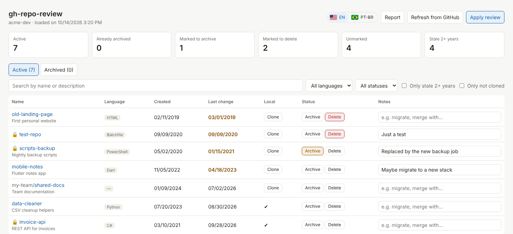

# gh-repo-review

[English](README.md) · **Português**

Uma pequena página local para **revisar todos os seus repositórios do GitHub num só lugar**: veja linguagem, datas e se cada um está clonado no seu computador, e **clone, arquive, desarquive ou exclua** com um clique.

Feito só com a biblioteca padrão do Python e o [GitHub CLI](https://cli.github.com/) oficial. Sem `pip install`, sem banco de dados, sem conta além do seu próprio login no GitHub.



## Funcionalidades

- Lista todos os repositórios que são seus (públicos e privados) — e, se quiser, também os das suas organizações
- Abas **Ativos** e **Arquivados**, cards de resumo e filtros (nome, linguagem, marcação, "parados", "não clonados")
- Marque repositórios para **arquivar** ou **excluir**, com uma observação livre — tudo salvo automaticamente
- **Clone** com um clique em `<pasta de projetos>/<linguagem>/<repositório>`, com seletor de pasta; o clone é conferido no final
- **Aplicar revisão** para arquivar/excluir no GitHub, com confirmação
- **Desarquivar** pela aba Arquivados
- **Relatório em HTML** do que foi excluído, arquivado e clonado, refletindo a situação atual (ex.: "pasta removida", "desarquivado em ...")
- Interface e relatórios em **inglês** ou **português (Brasil)**, trocando com um clique nas bandeiras
- Funciona em **Windows, macOS e Linux**

## Requisitos

| Ferramenta | Para quê |
|---|---|
| Python 3.8+ | Roda o servidor local |
| GitHub CLI (`gh`) | Conversa com o GitHub usando o seu login |
| Git | Usado para clonar os repositórios |

### 1. Instalar o Python

- **Windows:** baixe em [python.org/downloads](https://www.python.org/downloads/) e rode o instalador. Deixe marcado **"py launcher"** e marque **"Add python.exe to PATH"**. Ou no terminal: `winget install Python.Python.3.12`
- **macOS:** `brew install python` (com o [Homebrew](https://brew.sh)) ou o instalador do [python.org](https://www.python.org/downloads/)
- **Linux (Debian/Ubuntu):** `sudo apt install python3 python3-tk` — o `python3-tk` habilita o seletor de pasta (opcional)

Confira: `python --version` (Windows) ou `python3 --version` (macOS/Linux).

### 2. Instalar o Git

- **Windows:** [git-scm.com/download/win](https://git-scm.com/download/win) ou `winget install Git.Git`
- **macOS:** `xcode-select --install` ou `brew install git`
- **Linux:** `sudo apt install git`

### 3. Instalar e logar no GitHub CLI

- **Windows:** `winget install GitHub.cli`
- **macOS:** `brew install gh`
- **Linux:** siga as [instruções oficiais](https://github.com/cli/cli/blob/trunk/docs/install_linux.md)

Depois faça o login (abre o navegador):

```
gh auth login
```

Escolha **GitHub.com**, **HTTPS** ou **SSH** (o que você usa no git) e **Login with a web browser**. Confira com `gh auth status`.

**Só se quiser excluir repositórios**, adicione a permissão extra uma vez:

```
gh auth refresh -h github.com -s delete_repo
```

## Primeiros passos

```
git clone https://github.com/cristopherlima-dev/gh-repo-review.git
cd gh-repo-review
```

Para abrir:

- **Windows:** clique duas vezes em `abrir.bat` (dá para criar um atalho na área de trabalho)
- **macOS / Linux:** `./abrir.sh`
- **Qualquer sistema:** `python servidor.py` (ou `python3 servidor.py`)

Na primeira execução é criado um `config.json` a partir do `config.example.json`. **Abra e ajuste `pasta_projetos`** para a pasta onde você guarda seus clones, e rode de novo. A página abre em `http://localhost:8765`. Para encerrar, feche a janela do terminal ou aperte `Ctrl+C`.

## Configuração (`config.json`)

| Chave | Padrão | Descrição |
|---|---|---|
| `pasta_projetos` | `~/projetos` | Pasta com seus clones, organizada por linguagem (ex.: `D:\\PROJETOS` no Windows — use barras duplas) |
| `pasta_dados` | `dados` | Onde ficam revisão, histórico e relatórios. Relativo = dentro do projeto. Aponte para uma pasta sincronizada (Google Drive, OneDrive...) se quiser backup |
| `porta` | `8765` | Porta do servidor local |
| `anos_parado` | `2` | Repositórios sem push há mais tempo que isso ficam destacados |
| `permitir_excluir` | `false` | **Excluir vem desligado.** Com `false`, o botão some e o servidor recusa exclusões |
| `incluir_organizacoes` | `false` | Lista também os repositórios das organizações de que você participa |
| `abrir_navegador` | `true` | Abre o navegador sozinho ao iniciar |
| `idioma` | `en` | Idioma na primeira vez: `en` ou `pt-BR`. Depois, a página lembra a bandeira que você clicou |
| `pasta_sem_linguagem` | `outros` | Pasta usada para repositórios sem linguagem detectada |
| `apelidos` | ver arquivo | Linguagem no GitHub → nome da pasta (ex.: `"C#": "csharp"`). As demais viram minúsculo (`Python` → `python`) |

O `config.json` e a pasta de dados estão no `.gitignore` — suas configurações e dados nunca vão para o repositório.

## Como usar

1. Na aba **Ativos**, marque **Arquivar** ou **Excluir** e escreva observações. Sem marcação = manter.
2. Clique em **Clonar** para clonar um repositório que ainda não está no seu computador.
3. Clique em **Aplicar revisão** para arquivar/excluir no GitHub. Exclusões exigem digitar `EXCLUIR`.

> A interface abre em inglês por padrão. Clique na bandeira **PT-BR** no topo (ou use `"idioma": "pt-BR"` no `config.json`).
4. Na aba **Arquivados**, clique em **Desarquivar** se mudar de ideia.
5. Clique em **Relatório** para gerar o relatório em HTML em `<pasta_dados>/relatorios/` (no idioma selecionado).

| Ação | Efeito | Reversível? |
|---|---|---|
| Arquivar | O repositório fica somente leitura no GitHub | Sim — Desarquivar |
| Excluir | Apaga o repositório, o código e o histórico | **Não** |
| Desarquivar | O repositório volta a aceitar alterações | Sim — arquivando de novo |

Na dúvida, **arquive**.

## Seus dados

Tudo fica no seu computador, dentro da `pasta_dados`:

| Arquivo | Conteúdo |
|---|---|
| `revisao.json` | Suas marcações e observações |
| `historico.json` | Registro de todas as ações (clonado, arquivado, desarquivado, excluído) — nunca é apagado |
| `relatorios/` | Relatórios gerados |

## Segurança

- O servidor só escuta em `127.0.0.1` (o seu próprio computador).
- Cada sessão usa um token aleatório: só a página aberta pelo servidor consegue enviar comandos.
- Excluir vem desligado, precisa da permissão `delete_repo` no `gh` e da palavra `EXCLUIR` (ou `DELETE` em inglês) para confirmar.
- Todas as ações no GitHub passam pelo `gh` com o **seu** login; nada é enviado para outro lugar.

## Problemas comuns

| Problema | Solução |
|---|---|
| `gh` não encontrado / não logado | Instale o GitHub CLI e rode `gh auth login` |
| Erro ao ler o `config.json` | No Windows, use barras duplas nos caminhos: `"D:\\PROJETOS"` |
| Porta já em uso | Feche a outra janela do servidor ou mude a `porta` |
| Botão "Escolher…" mostra erro do tkinter (Linux) | `sudo apt install python3-tk`, ou digite o caminho no campo |
| Excluir falha com `delete_repo` | `gh auth refresh -h github.com -s delete_repo` |
| `abrir.sh: Permission denied` | `chmod +x abrir.sh` |
| `.bat` não encontra o Python ao abrir por atalho | O `abrir.bat` usa o `py.exe` do Windows; reinstale o Python marcando o *py launcher* |

## Estrutura do projeto

| Arquivo | Função |
|---|---|
| `servidor.py` | Servidor local e ações (clonar, arquivar, desarquivar, excluir, relatório) |
| `gerar_lista.py` | Busca os repositórios via `gh` e monta a página. Rodado sozinho, gera uma versão estática, só de leitura, em `saida/` |
| `relatorio.py` | Histórico de ações e relatório em HTML |
| `config.py` | Lê o `config.json` |
| `i18n.py` | Mensagens do servidor e do relatório em inglês e português |
| `template.html` | A página (HTML/CSS/JS, sem frameworks) |
| `abrir.bat` / `abrir.sh` | Lançadores para Windows / macOS-Linux |

## Como foi feito

Este projeto foi criado por **Cristopher Lima** em conjunto com o **Claude**, assistente de inteligência artificial da Anthropic. Eu defini o problema, as regras e as decisões de design, e testei cada etapa no meu próprio computador; a IA propôs as soluções e escreveu a maior parte do código. Compartilho isso abertamente porque acredito que é um retrato honesto de como software pode ser construído hoje.

## Autor

**Cristopher Lima** — [linkedin.com/in/cristopherlima-dev](https://www.linkedin.com/in/cristopherlima-dev)

## Licença

[MIT](LICENSE)
